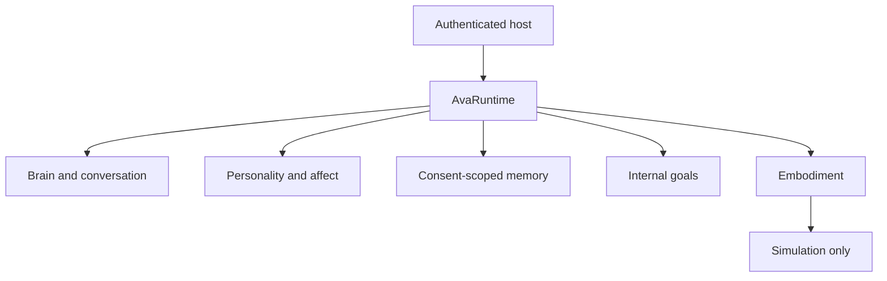

# AVA — one integrated system

## Single composition root

AVA has one owner-scoped application entrypoint: `AvaRuntime`. Components are
modules behind explicit contracts, not independent bots with separate memories,
permissions or task queues. Modular source files are not patchwork; one giant
file would weaken auditability and future hardware portability.

## Shared lifecycle

1. The host authenticates the owner and injects an approved reasoning engine.
   AVA does not discover credentials or silently select a paid provider.
2. `AvaRuntime.converse` optionally records a host-classified event in the
   synthetic-affect engine, then passes current expression guidance and only
   opt-in memories to the brain.
3. `AvaRuntime.choose_goal` ranks internal goals and records evidence-backed
   outcomes. Goals cannot confer authority or trigger real-world actions.
4. `AvaRuntime.simulate_body_command` requires a separate host authorization,
   refuses replay and physical device control, and returns a simulation receipt.
5. `AvaRuntime.status` reports real boundaries: it does not claim a verified
   model or enabled physical actuators.

## Required future integrations

| Capability | Stable interface | Current truth |
| --- | --- | --- |
| Cognition | `Brain` | Injected callback; no model connected |
| Personality | `AffectiveCompanion` | Synthetic expression; no sentience |
| Memory | `MemoryStore` | Opt-in ephemeral storage |
| Goal planning | `GoalProposer` | Internal goal ranking only |
| Embodiment | `RobotAdapter` | Read-only status and simulation |
| Unified coordination | `AvaRuntime` | Tested composition root |

To operate beyond this development library, the same runtime must gain:

- An evaluated, approved reasoning model or local model runtime.
- Encrypted, owner-isolated persistent memory and data deletion/backups.
- Secure tool adapter with audited per-action authorization and real receipts.
- A self-coding workflow: isolated changes, test/security gates, human-approved
  release when required, independent verification and rollback.
- Camera/audio perception with privacy permission, retention and deletion.
- Vendor SDK, hard physical safety limits, collision prevention, emergency
  stop and independent certification before any real motion.
- Reliable service lifecycle, monitoring and economically justified hosting.

## Acceptance rule

Tests measure one code version, not commercial readiness, real understanding,
conscious feeling, real attraction, or deployment. No purchases, messages,
trading, permission upgrades, hardware controls or production release are
authorized by a goal proposal or this document.

Run `python -m unittest discover -s tests -p 'test_ava*.py' -v` before review.
