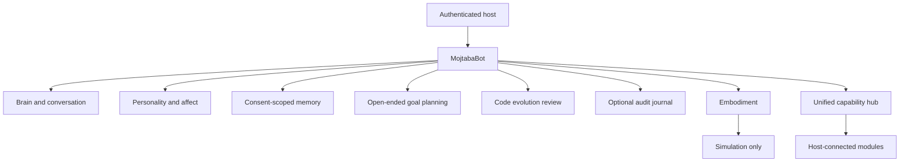

# Mojtaba.bot.ai — one bot, one runtime

## Single composition root

The only owner-scoped application entrypoint is `MojtabaBot`. "آوا" is the
owner's preferred conversational nickname, **not a separate bot**. Old imports
named `AvaRuntime` and `Ava` are aliases for backward compatibility. Modules
share one lifecycle and one owner. No standalone trading, messaging, game,
research or factory bot is created by this code.



## Shared lifecycle

1. The host authenticates the owner and injects an approved reasoning engine.
   Mojtaba.bot.ai does not discover credentials or silently select a paid provider.
2. `MojtabaBot.converse` optionally records a host-classified event in the
   synthetic-affect engine, then passes current expression guidance and only
   opt-in memories to the brain.
3. `MojtabaBot.choose_goal` ranks proposed goals across any domain, including
   plans for business, tools, research and new capabilities, and records
   evidence-backed outcomes. Even a selected goal cannot confer authority or
   trigger real-world actions.
4. `MojtabaBot.simulate_body_command` requires a separate host authorization,
   refuses replay and physical device control, and returns a simulation receipt.
5. `MojtabaBot.status` reports real boundaries: it does not claim a verified
   model or enabled physical actuators.
6. `MojtabaBot.propose_code_change` lets an injected code author prepare a
   multi-project, multi-language proposal with a configurable resource budget.
   The same runtime stages immutable diffs, checks exact source versions,
   parses Python/JSON syntax where supported, and never executes generated
   code. Any tested handoff requires independent evidence and permission.
7. `MojtabaBot.execute_action` routes requests through a single host-configured
   `CapabilityHub`. No adapter is connected automatically. Each operation
   declares its effect (`local`, `read`, `write`, `financial`, `destructive`,
   or `physical`). External operations require authorization for that precise
   action; all results are **adapter-reported**, not independently verified.

## Consolidation and legacy policy

| Existing name | Status inside the single bot | Proven integration today |
| --- | --- | --- |
| AVA / `AvaRuntime` | Alias to `MojtabaBot`, not another runtime | In-process alias identity tested |
| Conversation, goals and memory | Internal components of `MojtabaBot` | Implemented with injected providers |
| Code evolution and review | Internal components | Review and optional isolated Python tests only |
| MojTrade / OMEGA X | Future trading capability adapter | **Not connected** |
| Messaging/SMS assistants | Future communications adapter | **Not connected** |
| Product factory / services | Future production adapter | **Not connected** |
| Moj Coin / other games | Future games adapter | **Not connected** |
| Research and site management | Future research and site adapters | **Not connected** |

The registry does not invent capabilities: `connected_capabilities()` reports
only adapters supplied by the authenticated host. Migration requires (1)
inventory and versioning of old code and data, (2) one owner-scoped adapter
with compatible input/output contracts, (3) verified transfer and real
end-to-end operations, (4) a recoverable cutover, and **only then** retirement
of redundant services. Existing services are not deleted by declaring this
architecture. No content, account, repository or production data may be
removed on an unverified assumption of duplication.

## Required future integrations

| Capability | Stable interface | Current truth |
| --- | --- | --- |
| Cognition | `Brain` | Injected callback; no model connected |
| Personality | `AffectiveCompanion` | Synthetic expression; no sentience |
| Memory | `MemoryStore` | Opt-in RAM or encrypted SQLite adapter; key supplied by host |
| Goal planning | `GoalProposer` | Open-ended plans; no automatic external actions |
| Embodiment | `RobotAdapter` | Read-only status and simulation |
| Unified coordination | `MojtabaBot` | Tested composition root; not deployed |
| Capability integration | `CapabilityHub` | Typed routing, identity, approval and in-process anti-replay; **no live adapters** |
| Self-coding | `CodeEvolutionDirector` | Multi-project proposals/diffs; Python AST and JSON checks; no execution, commit or deployment |
| Code audit | `SQLiteCodeAuditTrail` | Optional HMAC-chained private journal for stage, tests, handoff and rollback plans |
| Rollback | `CodeRollbackPlan` | Immutable reversal intent checked against old/current SHA-256; no file operations |

To operate beyond this development library, the same runtime must gain:

- An evaluated, approved reasoning model or local model runtime.
- A host-managed private key, isolated storage permissions, secure backups,
  recovery and rotation for the encrypted-memory adapter.
- Connected service adapters, independently checked action receipts,
  durable transactional anti-replay state and recoverable workflow execution.
- A trusted isolated code test runner, security review, authenticated release
  governance, independent verification and reversible deployment/rollback.
- Camera/audio perception with privacy permission, retention and deletion.
- Vendor SDK, hard physical safety limits, collision prevention, emergency
  stop and independent certification before any real motion.
- Reliable service lifecycle, monitoring and economically justified hosting.

## Acceptance rule

Tests measure one code version, not commercial readiness, real understanding,
conscious feeling, real attraction, or deployment. No purchases, messages,
trading, permission upgrades, hardware controls or production release are
authorized by a goal proposal or this document.

Run `python -m unittest discover -s tests -p 'test*.py' -v` before review.

## Optional encrypted persistence within the same runtime

`EncryptedSQLiteMemory` implements the exact same `MemoryStore` contract. It
uses AES-256-GCM, separate derived lookup and encryption keys, authenticated
record metadata, a key verifier, SQLite transactions, and keyed owner tags.
Its only additional Python package is `cryptography`; the RAM-only default
has no added dependency. The host must explicitly supply a private 32-byte
key and database path; AVA never writes or discovers a key by itself.

```python
from ava_core import MojtabaBot, EncryptedSQLiteMemory

# `verified_brain`, `goal_proposer`, `authenticated_owner`, and `private_key`
# must come from the trusted host, not from the user's chat messages.
with EncryptedSQLiteMemory("/private-host-data/ava.db", key=private_key) as memory:
    runtime = MojtabaBot(
        owner_id=authenticated_owner, brain=verified_brain,
        propose_goals=goal_proposer, memory=memory,
    )
    runtime.remember("Owner-approved note", consent=True)
```

The example is **integration documentation**, not a deployed service. Keep the
key outside the database, restrict the containing directory, and do not include
the key or plaintext data in logs. The adapter checks file mode and refuses
symlinks, but deployment still needs independent threat modeling, key rotation,
verified backup/restore, privacy policy, per-request owner authentication,
multi-process stress tests and secure deletion of all backups. File permissions
alone do not guarantee isolation against an attacker controlling the same user
account or a compromised host. Deleting a record does not erase prior backups.

## Open-ended planning and coding — review-only boundary

**Freedom is an architectural principle:** Mojtaba.bot.ai can imagine and choose goals
for any field, including goals that would eventually require a payment, a new
permission, an external message or a physical device. These goals are *plans*,
not permissions. The decision carries an explicit reminder of any needed
authorization. Only an independent authenticated executor can take an
externally consequential action, and the owner's case-specific restrictions
remain effective.

The provider-neutral `CodeProposer` may use a host-approved model to suggest
`CodeProposal` objects. The director accepts ordinary text/source files across
any project in the host-provided snapshot and can stage 128 edits per review
by default. `DevelopmentScope` makes project roots and review-size budgets
configurable to match larger workloads. It refuses traversal, hidden paths,
secret-like files and binary formats; these are trust boundaries, not topic
filters. It requires exact SHA-256 base matches, parses Python syntax and JSON
where supported, and returns immutable diffs and hashes.
It cannot see files not passed by the authenticated host. It never writes to
the repository, invokes subprocesses, sends messages or publishes code.

```python
from ava_core import MojtabaBot, CodeEdit, CodeProposal

def code_proposer(goal, trusted_files):
    source = trusted_files["ava_core/example.py"]
    from hashlib import sha256
    return CodeProposal(
        goal=goal, rationale="A bounded internal improvement",
        edits=(CodeEdit(
            path="ava_core/example.py",
            expected_sha256=sha256(source.encode()).hexdigest(),
            new_source="value = 2\n",
        ),),
    )

runtime = MojtabaBot(
    owner_id="authenticated-owner", brain=verified_brain,
    propose_goals=goal_proposer, code_proposer=code_proposer,
)
review = runtime.propose_code_change(
    "Improve an internal function",
    trusted_files={"ava_core/example.py": "value = 1\n"},
)
assert review.syntax_checked
```

For wider code production, the host may inject
`development_scope=DevelopmentScope(project_roots=("business",),
max_edits=500, max_file_bytes=4_194_304, max_total_bytes=67_108_864)`
into `MojtabaBot`. Root paths use no leading or trailing slash.
A cross-language proposal can be staged with diffs and hashes,
but `syntax_checked=False` when a language has no trusted parser here.
The built-in isolated runner verifies only AVA Python regressions; wider
projects need their own independently validated isolated evaluator before a
handoff. No proposal automatically modifies the host's real source tree.

The example callback is deterministic demonstration code, not an installed
model. **Syntax checks are not security checks.** To obtain an
`ApprovedCodeBundle`, a separate authenticated host must supply a
`CheckEvidence` receipt tied to the exact review hash, positive results from
an isolated test environment, and an independent approval callback. Even a
successful bundle is only a handoff; it does **not** commit, merge or deploy.
The review pipeline now also supports an **optional Linux-only disposable test
runner** (`IsolatedReviewRunner`). It uses `unshare -Urn` followed by `bwrap`
with inherited empty network namespace, read-only source and system libraries,
fresh temporary filesystems, no host configuration mount, cleared environment,
CPU/memory/output limits and a wall-time timeout. The runner reconstructs an
allowlisted AVA Python tree entirely from the authenticated host's snapshot,
applies edits only inside a temporary directory, runs `test_ava*.py`, records
test counts/exit status/output digests, and destroys the staging directory.
The unified `MojtabaBot.evaluate_code_change` method is **disabled by default**
unless the host injects that runner.

The sandbox's successful execution and disposable cleanup have been tested on
the development environment, including network-denial and read-only checks.
They do not establish security certification, independent cryptographic proof
of test results, durable release audit, or a production rollback facility. If
namespace creation fails, evaluation **fails closed**; no direct-execution
fallback exists. A trusted host must separately verify evidence and explicitly
authorize a handoff; even then there is no commit, deployment or merge.

## Audited code handoff and rollback intent

The host may inject `SQLiteCodeAuditTrail` into the same `MojtabaBot` using the
`code_audit` argument. It must provide a distinct secret 32-byte key, a private
SQLite file path and authenticated owner identity. The journal keeps only event
kinds and cryptographic digests, not generated code, conversation content or
secret values. Each owner's events form an HMAC-SHA256 hash chain with a
separately stored current head and key verifier. The verifier detects modified
rows, reordered events and incomplete deletion of the tail; the store refuses
to append to an already-invalid chain. Reopening the file preserves events.

The runtime records `review_staged`, `review_evaluated_pass` / `fail`,
`handoff_approved` and `rollback_prepared`. When audit is configured, a
previously unlogged review cannot be evaluated. Only a successful `CheckEvidence`
actually returned by that runtime's isolated review runner may authorize a
handoff; fabricated or stale external claims are denied. These decisions share
the existing runtime owner identity and authority boundaries.

`MojtabaBot.prepare_code_rollback(review_id, trusted_before, trusted_current)`
compares every proposed file against its original and current SHA-256 digest.
For an existing file it creates an immutable instruction to restore its exact
old source; for a newly added file it creates an instruction to remove that
file. If either snapshot differs from the reviewed versions, the plan is
rejected. No source file is overwritten, removed or deployed by generating the
plan. An independently authorized deployment adapter, backup and actual
production recovery process must be built and verified separately.

**Integrity limit:** HMAC chaining does not stop whole-database replay or
coordinated rollback of both chain and head by someone who controls the journal.
Strong independent proof requires a periodically exported head commitment in
a separate trusted location and controlled key rotation. The locally generated
test receipt is not cryptographically signed or independently certified.
