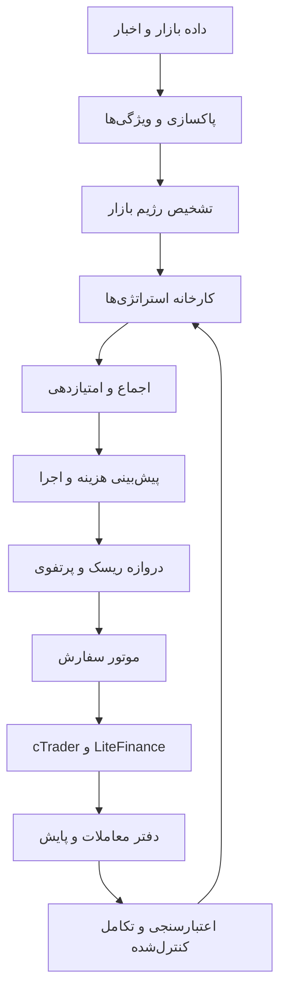

# سند ساخت مرجع MojTrade OMEGA X

## وضعیت سند

- نوع: سند مرجع ساخت و پذیرش
- محصول: MojTrade OMEGA X
- هدف: سامانه معاملاتی تطبیقی، خودتکامل کنترل‌شده و عملیاتی
- وضعیت فعلی: طراحی کامل؛ پیاده‌سازی در حال انجام
- حساب واقعی: قفل کامل
- محیط مجاز فعلی: تحقیق، تست و حساب دمو
- سوددهی: تا زمان فوروارد دمو و گزارش پس از هزینه‌ها اثبات‌نشده

این سند تمام اهداف توافق‌شده را یکپارچه می‌کند. هیچ بخشی با «تعداد اندیکاتور» جایگزین معماری، اعتبارسنجی، اجرای واقعی و کنترل ریسک نمی‌شود.

## ۱. معماری کلان



سامانه از دو بخش تشکیل می‌شود:

1. **Execution Core در cTrader:** دریافت داده، تصمیم نهایی، مدیریت پوزیشن و اجرای سفارش.
2. **Research and Evolution Core روی VPS:** داده تاریخی، اعتبارسنجی، تولید نسل، گزارش، مقایسه و آماده‌سازی نسخه.

هسته تحقیق حق ارسال مستقیم سفارش ندارد. حساب واقعی نیز تا پذیرش رسمی قفل می‌ماند.

## ۲. لایه داده و ویژگی‌ها

- تیک و کندل چندتایم‌فریمی
- اسپرد لحظه‌ای
- حجم، سرعت حرکت و نوسان
- کیفیت نقدینگی در صورت دسترسی
- تقویم اقتصادی و اخبار
- دلار، بازده اوراق، نفت و شاخص‌ها برای XAUUSD
- BTCUSD و ETHUSD برای همبستگی و واگرایی
- قیمت مورد انتظار، قیمت واقعی اجرا، اسلیپیج و تأخیر LiteFinance

ربات باید بین **قیمت مناسب برای تحلیل** و **قیمت واقعاً قابل معامله** تفاوت بگذارد.

## ۳. تشخیص رژیم بازار

رژیم‌های اجباری:

- روند صعودی و نزولی
- رنج
- شکست معتبر و شکست جعلی
- نوسان فشرده و انفجاری
- بازار خبری
- نقدینگی ضعیف
- اسپرد غیرعادی
- وضعیت نامطمئن

هر استراتژی فقط در رژیم مجاز خودش فعال می‌شود. در وضعیت نامطمئن، خروجی پیش‌فرض **عدم معامله** است.

## ۴. کارخانه استراتژی‌ها

استراتژی‌ها مستقل و نمادمحور هستند:

- روند چندتایم‌فریمی
- مومنتوم
- شکست ساختاری
- شکست جعلی
- بازگشت به میانگین
- اسکالپ نوسان
- واگرایی قیمت و حجم
- ادامه حرکت پس از خبر
- برگشت پس از جهش
- همبستگی طلا و دلار
- واگرایی BTC و ETH
- جلسه لندن
- جلسه نیویورک
- محافظ سرمایه در بحران

هیچ استراتژی به‌تنهایی سفارش ارسال نمی‌کند.

## ۵. موتور اجماع و امتیازدهی

امتیاز هر فرصت بر اساس موارد زیر محاسبه می‌شود:

- ساختار بازار
- توافق تایم‌فریم‌ها
- قدرت روند یا بازگشت
- حجم و نقدینگی
- هزینه ورود
- فاصله حدضرر
- نسبت سود به ریسک
- ریسک خبر
- همبستگی با معاملات باز
- عملکرد اخیر استراتژی
- کیفیت اجرای کارگزار

خروجی فقط یکی از این سه حالت است:

1. ورود مجاز
2. ورود با حجم کاهش‌یافته
3. عدم معامله

## ۶. موتور اختصاصی XAUUSD

- واکنش به دلار و بازده اوراق
- خبرهای تورم، اشتغال و نرخ بهره
- بازشدن لندن و نیویورک
- جهش نقدینگی
- تغییر اسپرد هنگام خبر
- تشخیص حرکت واقعی و شکست جعلی
- توقف زمانی که حدضرر عادی قابل‌اعتماد نیست

منطق XAUUSD با BTCUSD و ETHUSD یکسان نیست.

## ۷. موتور اجرای سفارش

قبل از سفارش:

- انتخاب Market یا Limit
- محاسبه قیمت قابل‌قبول
- تعیین اسلیپیج مجاز
- تطبیق حجم با مارجین واقعی
- بررسی اتصال و پاسخ کارگزار
- لغو سفارش در شرایط بد

بعد از سفارش:

- مقایسه قیمت مورد انتظار و اجرا
- ثبت اسپرد، کمیسیون، اسلیپیج و تأخیر
- تأیید ثبت حدضرر و حدسود
- مدیریت سفارش ناقص
- بازیابی پس از قطعی
- توقف در خطای اجرای حساس

## ۸. مدیریت ریسک پرتفوی

- ریسک هر معامله و کل حساب
- ریسک هم‌زمان نمادهای همبسته
- سقف معاملات باز
- سقف زیان روزانه و هفتگی
- سقف زیان متوالی
- حداکثر افت سرمایه
- کاهش خودکار حجم پس از افت
- توقف کامل در بحران
- ممنوعیت مارتینگل
- ممنوعیت میانگین کم‌کردن بدون مجوز
- ممنوعیت افزایش ریسک برای جبران زیان

## ۹. هسته خودتکامل و تولید نسل

خودتکامل فقط در محیط تحقیق و دمو انجام می‌شود. تغییر بی‌ضابطه کد در حساب واقعی ممنوع است.

هر استراتژی دارای ژنوم است که موارد زیر را کنترل می‌کند:

- نماد و تایم‌فریم
- پارامترهای ورود
- نوع استراتژی
- فیلتر روند و خبر
- ATR و حدضرر
- نسبت سود به ریسک
- سقف اسپرد
- آستانه ورود
- ریسک معامله
- حداکثر معاملات
- نوع خروج
- شرایط عدم معامله

چرخه تولید نسل:

```text
نسل اولیه
→ آزمون تاریخی
→ آزمون خارج از نمونه
→ حذف ژن‌های ضعیف
→ انتخاب والدین
→ ترکیب ژنوم
→ جهش محدود
→ آزمون هزینه و اسلیپیج
→ فوروارد دمو در حالت سایه
→ تأیید یا حذف نسل
```

عملیات ژنتیکی:

- انتخاب والدین بر اساس امتیاز چندمعیاره
- ترکیب دو ژنوم معتبر
- جهش محدود و دارای دامنه ایمنی
- حذف ژن‌های بیش‌برازش‌شده
- نگهداری بهترین نسل قبلی
- امکان بازگشت فوری
- شماره‌گذاری نسل‌ها و ثبت شناسنامه ژنتیکی

### Champion / Challenger

- **Champion:** نسخه فعال و تأییدشده
- **Challenger:** نسل جدید در آزمون
- Challenger ابتدا فقط در حالت سایه اجرا می‌شود.
- جایگزینی فقط پس از برتری خارج از نمونه و فوروارد دمو انجام می‌شود.
- Champion سالم همیشه برای بازگشت نگهداری می‌شود.

## ۱۰. تابع امتیاز نسل‌ها

```text
Fitness =
سود خالص پس از هزینه
- جریمه افت سرمایه
- جریمه اسلیپیج
- جریمه تعداد معاملات
- جریمه ناپایداری
- جریمه پیچیدگی
+ پایداری در چند بازار
+ پایداری در چند رژیم
```

نسلی که سود بالا ولی افت سرمایه شدید یا ناپایداری داشته باشد رد می‌شود.

## ۱۱. دوقلوی معاملاتی

قبل از هر معامله سه سناریو بررسی می‌شود:

- عادی
- بد
- شوک

در حالت سایه، روش‌های مختلف ورود، حدضرر، تأخیر و هزینه مقایسه می‌شوند. معامله‌ای که در سناریوی بد زیان نامتناسب داشته باشد حذف یا کوچک می‌شود.

## ۱۲. اعتبارسنجی اجباری

هیچ نسل یا استراتژی بدون عبور از همه موارد زیر فعال نمی‌شود:

- داده پاک و بدون نگاه به آینده
- تفکیک آموزش و آزمون
- Walk-Forward
- Purged Cross-Validation
- Embargo
- DSR و PSR
- آزمون خارج از نمونه
- مونت‌کارلو
- آزمون هزینه
- آزمون اسپرد و اسلیپیج
- آزمون تأخیر
- آزمون چندنمادی و چندتایم‌فریمی
- آزمون بحران
- فوروارد دمو

## ۱۳. دفتر معاملات و مدیریت فارسی

برای هر تصمیم ثبت می‌شود:

- زمان و نماد
- داده‌های ورودی
- رژیم بازار
- استراتژی و نسل فعال
- امتیاز سیگنال
- دلیل ورود یا عدم ورود
- قیمت مورد انتظار و واقعی
- اسپرد، اسلیپیج و کمیسیون
- حدضرر و حدسود
- علت خروج
- سود یا زیان خالص
- پیش‌بینی در برابر نتیجه واقعی

داشبورد فارسی باید وضعیت ربات، معاملات، سود و زیان، هزینه‌ها، افت سرمایه، عملکرد نسل‌ها، خطاها، کیفیت کارگزار، هشدارها و گزارش حسابداری را نشان دهد.

## ۱۴. امنیت و قفل‌ها

- قفل کامل حساب واقعی
- عدم امکان برداشت
- عدم امکان تغییر مقصد پول
- سقف حجم و تعداد معاملات
- توقف اضطراری
- توقف در خطای داده
- توقف در خطای حدضرر
- توقف در اختلاف موجودی
- ثبت تمام تغییرات تنظیمات
- عدم انتشار خودکار نسل به حساب واقعی

## ۱۵. ساختار کد

```text
MojTrade/
├── trading/
│   ├── MojTradeExecutionBot.cs
│   ├── MarketRegimeEngine.cs
│   ├── StrategyEngine.cs
│   ├── SignalConsensus.cs
│   ├── RiskPortfolioEngine.cs
│   ├── ExecutionEngine.cs
│   ├── PositionManager.cs
│   └── EmergencyStop.cs
├── evolution/
│   ├── StrategyGenome.cs
│   ├── MutationEngine.cs
│   ├── CrossoverEngine.cs
│   ├── FitnessEngine.cs
│   ├── ChampionChallenger.cs
│   └── GenerationRegistry.cs
├── research/
│   ├── data_pipeline/
│   ├── backtest/
│   ├── walk_forward/
│   ├── purged_cv/
│   ├── cost_model/
│   └── monte_carlo/
├── monitoring/
│   ├── trade_journal/
│   ├── health_monitor/
│   └── reports/
├── configs/
│   ├── XAUUSD.json
│   ├── BTCUSD.json
│   └── ETHUSD.json
└── tests/
```

## ۱۶. معیار پذیرش نسخه نهایی

نسخه نهایی فقط زمانی پذیرفته می‌شود که:

- کامپایل بدون خطا داشته باشد؛
- تمام آزمون‌های واحد و یکپارچه موفق باشند؛
- روی حساب دمو معامله واقعی ثبت کند؛
- سفارش، حدضرر و حدسود درست اجرا شوند؛
- قطعی و خطا را مدیریت کند؛
- دفتر کامل معاملات تولید کند؛
- پس از هزینه‌ها عملکرد قابل‌قبول داشته باشد؛
- در داده خارج از نمونه شکست جدی نداشته باشد؛
- در فوروارد دمو پایدار بماند؛
- افت سرمایه کنترل‌شده باشد؛
- Champion/Challenger و بازگشت نسخه سالم کار کند؛
- حساب واقعی همچنان تا تأیید نهایی قفل بماند.

تا قبل از این مرحله، محصول فقط «در حال ساخت و اعتبارسنجی» است و ادعای درآمد یا برتری قطعی مجاز نیست.

## ۱۷. گسترش قابلیت‌ها برای هدف ۱۰۰۰/۱۰۰۰

امتیاز ۱۰۰۰ فقط با زیادکردن اندیکاتورها به‌دست نمی‌آید. قابلیت‌ها باید در ده حوزه کامل شوند:

### الف) هوش داده و بازار

- تشخیص کیفیت هر منبع داده
- مقایسه قیمت چند منبع
- تشخیص اختلاف قیمت و گپ
- تشخیص تغییر سرعت بازار
- تشخیص فشردگی و آزادشدن نوسان
- تشخیص شکار حدضرر و شکست کاذب
- تشخیص رفتار غیرعادی اسپرد
- تشخیص زمان‌های کم‌عمق بازار
- نقشه نقدینگی و فشار خرید/فروش
- امتیاز اطمینان داده قبل از تصمیم

### ب) هوش رویداد و اقتصاد کلان

- تقویم اقتصادی طبقه‌بندی‌شده بر اساس اهمیت
- تحلیل قبل، هنگام و بعد از خبر
- تشخیص اختلاف پیش‌بینی و نتیجه خبر
- تحلیل واکنش واقعی بازار به خبر
- تشخیص خبرهای هم‌زمان و متناقض
- مدل ارتباط دلار، طلا، اوراق، نفت و شاخص‌ها
- تشخیص تغییر رژیم کلان
- کاهش خودکار ریسک قبل از رویداد مهم
- تحلیل اثر خبر با تأخیر زمانی
- دفتر اثرگذاری رویدادها بر هر نماد

### ج) کارخانه آلفا

- تولید خودکار فرضیه‌های معاملاتی
- ترکیب چند ویژگی غیرتکراری
- متالبلینگ برای فیلترکردن سیگنال ضعیف
- مدل جداگانه برای ورود و خروج
- مدل جداگانه برای اندازه موقعیت
- مدل احتمال موفقیت
- مدل احتمال رسیدن به حدضرر
- مدل پیش‌بینی ماندگاری حرکت
- کشف واگرایی بین نمادها
- تولید سیگنال بدون وابستگی به یک اندیکاتور

### د) هوش پرتفوی

- تخصیص سرمایه بر اساس ریسک
- تخصیص سرمایه بر اساس کیفیت نسل
- کنترل ریسک عاملی
- کنترل همبستگی پنهان
- تشخیص تمرکز ناخواسته
- بودجه ریسک برای هر نماد
- بودجه ریسک برای هر استراتژی
- بودجه ریسک برای هر جلسه معاملاتی
- تعادل بین فرصت و حفظ سرمایه
- حالت دفاعی کل پرتفوی

### هـ) اجرای تطبیقی

- تشخیص بهترین نوع سفارش
- زمان‌بندی ورود در چند مرحله
- خروج جزئی هوشمند
- اجرای پله‌ای حجم
- کنترل فاصله قیمت تا سفارش
- پیش‌بینی احتمال پرشدن سفارش
- برآورد هزینه قبل از معامله
- انتخاب زمان کم‌هزینه‌تر
- مدل اختصاصی رفتار LiteFinance
- سنجش کیفیت اجرا در هر ساعت و نماد

### و) خودتکامل پیشرفته

- ژن‌های داده
- ژن‌های ویژگی
- ژن‌های رژیم بازار
- ژن‌های ورود
- ژن‌های خروج
- ژن‌های ریسک
- ژن‌های اجرا
- ژن‌های زمان‌بندی
- جهش کنترل‌شده
- ترکیب چندوالدی
- انتخاب چندهدفه و Pareto Front
- جلوگیری از تکامل به سمت معاملات بیش‌ازحد
- بازنشستگی ژن‌های فرسوده
- آرشیو کامل نسل‌ها
- بازگشت به هر نسخه سالم

### ز) یادگیری و حافظه معاملاتی

- حافظه رفتار هر نماد
- حافظه رفتار هر ساعت
- حافظه رفتار هر خبر
- حافظه خطاهای پیش‌بینی
- حافظه اسلیپیج
- حافظه عملکرد هر استراتژی
- تشخیص تغییر توزیع داده
- تشخیص افت کیفیت سیگنال
- تشخیص بیش‌برازش جدید
- بازتنظیم فقط با شواهد کافی

### ح) دوقلوی دیجیتال و آزمایشگاه

- بازپخش دقیق بازار
- بازپخش با اسپرد واقعی
- بازپخش با تأخیر واقعی
- بازپخش با سفارش ناقص
- بازپخش با قطعی ارتباط
- بازپخش با جهش خبر
- مقایسه چند مسیر اجرای سفارش
- آزمون فشار چندروزه
- آزمون ورشکستگی سناریویی
- آزمون بازگشت از خطا

### ط) عملیات و زیرساخت

- پایش سلامت لحظه‌ای
- پایش مصرف منابع
- کنترل نسخه و تنظیمات
- انتشار مرحله‌ای
- بازگشت خودکار نسخه
- صف رویدادها
- جلوگیری از اجرای تکراری سفارش
- قفل تراکنشی
- پشتیبان‌گیری رمزنگاری‌شده
- گزارش خرابی و زمان بازیابی

### ی) مدیریت، حسابداری و تصمیم‌یار

- گزارش فارسی روزانه
- گزارش فارسی هفتگی
- صورت سود و زیان واقعی
- تفکیک سود استراتژی‌ها
- تفکیک هزینه‌ها
- گزارش مالیاتی قابل استخراج
- هشدار افت سرمایه
- هشدار فرسودگی استراتژی
- ثبت تصمیم‌های مدیریتی
- امکان توقف، ادامه و کاهش ریسک از داشبورد

## ۱۸. شاخص امتیازدهی ۱۰۰۰/۱۰۰۰

امتیاز نهایی از ده بخش ۱۰۰ امتیازی تشکیل می‌شود:

| حوزه | امتیاز |
|---|---:|
| داده و کیفیت بازار | ۱۰۰ |
| هوش رویداد و اقتصاد کلان | ۱۰۰ |
| کشف آلفا و استراتژی | ۱۰۰ |
| پرتفوی و سرمایه | ۱۰۰ |
| اجرای تطبیقی | ۱۰۰ |
| خودتکامل و ژنوم | ۱۰۰ |
| حافظه و یادگیری کنترل‌شده | ۱۰۰ |
| دوقلو و آزمایشگاه | ۱۰۰ |
| زیرساخت و عملیات | ۱۰۰ |
| مدیریت، حسابداری و امنیت | ۱۰۰ |
| **جمع کل** | **۱۰۰۰** |

هر حوزه فقط با وجود کد، تست، گزارش و اجرای قابل مشاهده امتیاز کامل می‌گیرد. ایده ثبت‌شده بدون پیاده‌سازی امتیاز کامل ندارد.


## ۱۹. نسخه تکمیلی APEX 1300 — معیار تمایز جهانی

این سند ۵۰۰ خطی و تمام الزامات آن **بدون حذف** حفظ می‌شود. مشخصات مهندسی تکمیلی، مقایسه مستند با QuantConnect/LEAN، Freqtrade، Hummingbot، NautilusTrader و cTrader، ۱۳ محور ارزیابی، ۱۲ راهبرد مستقل، قراردادهای داده و سفارش، مدیریت ریسک مشترک، دوقلوی اجرا و ۲۴ معیار پذیرش در سند زیر تعریف شده‌اند:

[سند مرجع تکمیلی APEX 1300](MojTrade_OMEGA_X_APEX_1300_Architecture.md)

- امتیاز پایه: ۱۰ حوزه × ۱۰۰ = ۱۰۰۰.
- معیار تمایز افزوده: سه حوزه × ۱۰۰ = ۳۰۰.
- هدف طراحی و پذیرش: سقف جدید **۱۳۰۰**؛ هیچ امتیاز اجرایی بدون کد، آزمون معتبر و شواهد مستقل داده نمی‌شود.
- نسخه حاضر معماری هدف است، نه گواهی اجرا، سودآوری یا برتری اثبات‌شده نسبت به محصولات دیگر.
- حساب واقعی، انتشار سیگنال عمومی، هزینه، ارسال ایمیل و استقرار بدون مجوز جداگانه همچنان غیرفعال‌اند.
